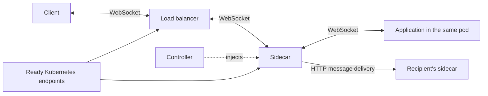

# WebSocket Operator for Kubernetes

An experimental Go project for routing long-lived WebSocket connections and
messages across application pods. Inspired by
[this distributed WebSocket architecture](https://medium.com/lumen-engineering-blog/how-to-implement-a-distributed-and-auto-scalable-websocket-server-architecture-on-kubernetes-4cc32e1dfa45).

## How the components fit together

- The **controller** is an admission webhook. It injects a proxy container into
  Deployments labeled `ws.operator/enabled: "true"` and creates a headless Service.
- The **load balancer** maps each connecting user to a sidecar using jump consistent
  hashing over the currently discovered peers.
- The **sidecar** connects to the application on `localhost:3001`. It routes incoming
  messages to the recipient's application connection, locally or through another
  sidecar's HTTP endpoint. Application replies travel back over the recipient's
  WebSocket connection.



Both applications currently use **jump hashing**. The repository also contains an
alternative rendezvous implementation, which is not selected by these entry points.

## Routing contract

Connect with a `ws-user-id` HTTP header identifying the user. The load balancer and
sidecar reject a handshake without it. Client messages are JSON with a string
recipient ID, for example:

```json
{"recipientId":"bob","message":"hello"}
```

The complete JSON message reaches Bob's application connection. The demo application
returns `Server received: ...` to Bob; this is application behavior, not a protocol
response generated by the operator. The sidecar is not a transparent echo proxy for
arbitrary binary/non-JSON client payloads. This header is routing metadata, not
proof of authentication; an application deployment must establish user identity.

## Build and test from the repository root

Use Go 1.24.9 (see `go.mod`). Docker is needed only for image builds, and a Kubernetes
cluster is needed only for the integration tests and running the applications.

```sh
go mod download
go build ./...
make test
make test-race
FUZZTIME=30s bash scripts/test-behavior.sh
make build  # builds controller, loadbalancer, and sidecar images
```

`make build-sidecar` builds one component. `REGISTRY` (default `docker.io`),
`REPOSITORY` (default `lukas8219`), and `TAG` (default `latest`) customize image names.
`make push` explicitly builds and publishes them to that registry.

For cluster-based peer-discovery tests, select a dedicated cluster with `KUBECONFIG`
and follow [the integration instructions](integration_tests/README.md). Unit/race
checks do not require a cluster; fuzz mutation campaigns are run by the script above.

## Running in Kubernetes

See [the controller deployment instructions](cmd/controller/README.md). The raw
manifests are development examples using the `default` application namespace,
`websocket-system` controller namespace, and `ws-proxy-headless` Service. The
applications currently discover peers in `default`; changing only a manifest's
namespace is insufficient to move the application.

Component details: [sidecar](cmd/sidecar/README.md),
[demo server/client](deployments/local/README.md), and
[behavioral testing](docs/testing/fuzz-review.md).

## Configuring the routing identity header

Set `WS_OPERATOR_USER_HEADER` consistently on the load balancer and every sidecar
(default: `ws-user-id`). The example ConfigMap supplies it to both. For example,
`X-App-User` selects that header for client handshakes, upstream handshakes, and
internal HTTP delivery. Configure clients to send the same name. Empty/invalid
names and HTTP/WebSocket protocol headers are rejected at startup. This setting
does not change the JSON `recipientId` field or add authentication.

System CI runs the full routing and recovery suite with both `ws-user-id` and
`X-App-User`. Reproduce the custom-header run with
`WS_OPERATOR_USER_HEADER=X-App-User make system-test`.

For a namespace-scoped install, set `WS_OPERATOR_NAMESPACE` and
`WS_OPERATOR_SERVICE` on both Go routing components (defaults: `default` and
`ws-proxy-headless`). The controller accepts `-service-name` and `-config-map`
to select that same discovery Service and the injected sidecar configuration.
Each routing pool supports one labeled application Deployment.
