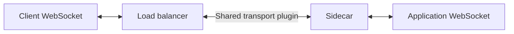

# Shared load-balancer and sidecar transport

Both binaries select the same compiled plugin. The current one-way `Transport`
interface only covers sidecar-to-sidecar delivery; it cannot represent opening a
client session or returning application replies to the owning load balancer.

The new `link.Endpoint` opens and accepts `link.Session` objects. A session reads
and writes complete messages, preserves text/binary opcodes and payload bytes,
and closes independently of other sessions. Application routing stays in the
sidecar. The load balancer selects the sidecar for a user's session; it does not
need to understand the application's message format.

The default plugin uses WebSocket sessions between the components and HTTP for
cross-sidecar delivery. LavinMQ implements the same session contract over AMQP,
including open, ready, data, close, and peer-liveness messages. It keeps the
existing broker-confirmed sender, bounded queues, and no-implicit-retry policy.
A publisher confirmation proves broker acceptance; an explicit ready response
proves that the sidecar prepared the application connection.

Each load balancer and sidecar has its own inbox. Random session IDs distinguish
reconnections and simultaneous clients; replies target the load balancer that
opened the session. A receiver checks the session's peer before accepting data
or close events. Closed sessions cannot receive late replies. Endpoint failure,
setup deadlines, queue overflow, and peer expiry close affected sessions and
release application sockets. Session IDs are never reused during rebalancing.

The shared compiled factory owns backend selection and configuration. Neither
binary imports a concrete broker implementation. Both roles must receive the
same plugin setting, broker Secret, namespace, and service configuration. A
sidecar handler connects the session to its application; a load-balancer handler
connects it to its client. The external WebSocket protocols stay unchanged.

Implementation is split into independently testable PRs of at most about 300
changed lines: session contract/adapters, direct backend, broker wire/session
state, broker endpoint, shared factory, host integration, and deployment/E2E
coverage. The feature is complete only when a test runs two load balancers and
multiple sidecars through a real broker and verifies replies, isolation, close,
failure cleanup, and the unchanged direct default.
