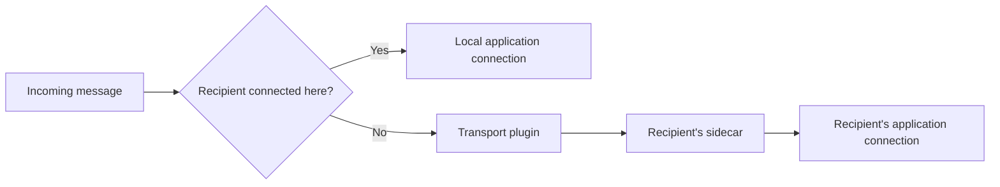

# Routed-message transport plugins

The sidecar first extracts a recipient and checks its local connection registry.
If that recipient is connected here, it writes directly to the recipient's
application connection. Otherwise it calls the selected transport plugin:

```go
type Transport interface {
    Write(recipient []byte, opcode ws.OpCode, payload []byte) error
}
```



The plugin resolves the destination sidecar and transports the recipient key,
opcode, and unchanged payload. HTTP is the default implementation; LavinMQ
publishes to that sidecar's broker queue. The receiving sidecar delivers locally.
If the recipient has disconnected, delivery fails instead of forwarding again.

Client connections remain WebSockets through the load balancer and sidecar.
Application replies return over the recipient's existing WebSocket connection.
The plugin has no session-open, session-ready, or session-close protocol and
does not need per-client broker session IDs or session heartbeats. A backend can
still own an HTTP client or AMQP connection and expose its own failure/shutdown
lifecycle; these resources are separate from client sessions.

For Go readers: the interface belongs to `internal/transports`, so any component
that needs routed-message delivery can use the same contract. Implementations
and callers agree that `Write` borrows its slices until it returns and must not
mutate them. The current load balancer proxies connections and does not need a
broker endpoint. Sharing a transport implementation does not require putting
every connection through it.

Extensions are compiled Go factories selected by `WS_OPERATOR_TRANSPORT_PLUGIN`.
See [the LavinMQ contract and configuration](lavinmq-transport.md).

The session-based proposal in PRs #87–#101 was withdrawn. This document records
the narrower routed-message boundary already implemented on `main`.
